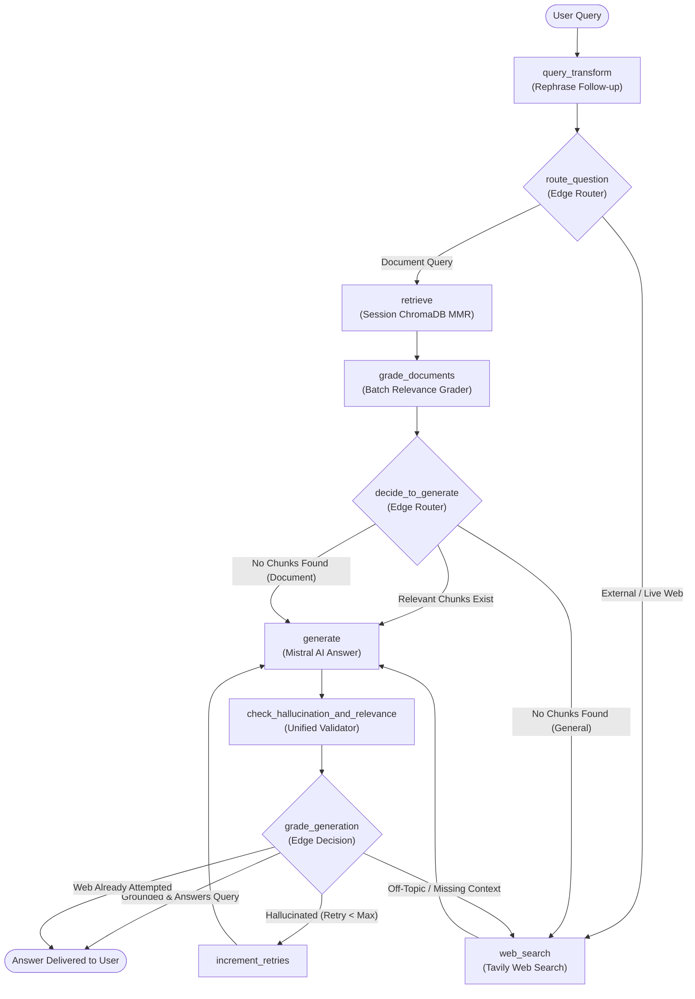

# 🧠 Multimodal Agentic Corrective RAG (CRAG) Assistant

A production-ready, self-correcting **Agentic Retrieval-Augmented Generation (CRAG)** application built with **LangGraph**, **Docling**, **ChromaDB**, **Mistral AI**, and **Streamlit**.

The system features **layout-aware multimodal parsing**, **multi-session chat isolation** (like ChatGPT & Gemini), **self-correcting verification loops** for hallucinations and answer quality, and **smart web fallback** via Tavily.

---

## 🌟 Key Features

* **📑 Layout-Aware Multimodal Ingestion (IBM Docling)**:
  * Automatically extracts and preserves reading order, complex tables, headings, and document structure.
  * Supports 11 document formats: **PDF**, **DOCX**, **PPTX**, **XLSX**, **HTML**, **Markdown**, and Images (**PNG**, **JPG**, **JPEG**, **BMP**, **TIFF**).
* **🔄 Self-Correcting Agentic CRAG Pipeline (LangGraph)**:
  * **Query Optimization**: Rewrites conversational follow-up questions into standalone semantic queries without context explosion.
  * **Batch Document Grading**: Evaluates retrieved chunks in a single LLM pass to eliminate API bottlenecks.
  * **Dual Self-Check**: Evaluates both factual grounding (hallucination detection) and query relevance before presenting answers.
  * **Loop-Guarded Fallback**: Guaranteed termination with cycle-prevention and controlled retry limits.
* **💬 Multi-Session Chat Isolation (ChatGPT & Gemini style)**:
  * Create, switch, rename, and delete independent chat sessions.
  * **100% Isolated Contexts**: Each chat session maintains its own vector store in `chroma_db/sessions/<session_id>/`.
  * **Identical Filename Protection**: Uploading two documents with the exact same name (e.g. `resume.pdf`) across different chats maintains strict isolation with zero cross-contamination.
  * **Persistent Storage**: Sessions, message histories, and document metadata persist across browser refreshes and server reboots via `sessions_registry.json`.
* **🌐 Smart Web Search Fallback (Tavily)**:
  * Queries requiring real-time external data or unindexed general concepts fall back to Tavily web search.
  * **Private Document Safeguard**: The router never falls back to the public web for private document questions (e.g. personal resumes or private files).
* **⚡ Real-Time Streaming UI & Observability (Streamlit)**:
  * Interactive step-by-step progress tracking with `st.status` (no endless mystery spinners).
  * Expandable source citations displaying document filename, section headers, and content previews.
  * Centralized logging system writing to both console and `rag_assistant.log`, with a live in-app sidebar viewer and download button.

---

## 🔄 App Flow & Pipeline Architecture

The assistant executes an agentic state graph compiled via **LangGraph**. The workflow dynamically evaluates the quality of retrieval and generation at every step.

### CRAG State Graph Diagram



---

### Step-by-Step Execution Lifecycle

1. **Query Transform (`query_transform`)**:
   * If there is no previous history (Turn 1), the original question passes through directly to save latency and API quota.
   * On follow-up questions, Mistral AI resolves coreferences and reformulates the prompt using the last 2 conversation turns into a standalone query.
2. **Smart Query Routing (`route_question`)**:
   * Inspects user intent. If document keywords are detected or a session document is active, it routes to `retrieve`.
   * Only routes directly to `web_search` if the user explicitly asks for external, live, or real-time web events.
3. **Session-Isolated Retrieval (`retrieve`)**:
   * Queries the active session's private Chroma collection using **MMR (Maximal Marginal Relevance)** (`k=4`, `fetch_k=10`, `lambda_mult=0.5`) to maximize context diversity and minimize redundancy.
4. **Batch Document Grading (`grade_documents`)**:
   * Evaluates all retrieved chunks in a single structured LLM call. Retains only the chunks that are relevant to answering the question.
5. **Decide to Generate (`decide_to_generate`)**:
   * If relevant chunks exist, proceeds directly to `generate`.
   * If 0 chunks survive for a private document query, it skips web search and lets the generator honestly report that the document lacks the requested detail.
   * If 0 chunks survive for a general topic, it triggers a Tavily web search.
6. **Grounded Generation (`generate`)**:
   * Mistral AI generates a concise, strictly factual answer synthesizing the surviving context chunks.
7. **Unified Grounding & Relevance Check (`check_hallucination_and_relevance`)**:
   * Evaluates the response in a single structured output call:
     * **Groundedness (`binary_score`)**: Verifies whether claims are supported by the provided text. Factual admissions of missing information are scored as grounded.
     * **Answer Quality (`answer_grade`)**: Validates that the response directly addresses the user's inquiry.
8. **Generation Grading & Cycle Guard (`grade_generation`)**:
   * If grounded and relevant: Terminates immediately to `END`.
   * If hallucination is detected: Retries generation once (`retries < 1`).
   * If web search was already attempted: Terminates to `END`, eliminating any possibility of infinite loops.

---

## 🗂️ Multi-Session Context Isolation

A key architectural enhancement is **session-level context isolation**, mirroring ChatGPT and Google Gemini.

```
chroma_db/
├── sessions_registry.json            <-- Global registry of all chat sessions
└── sessions/
    ├── a1b2c3d4/                     <-- Chat Session 1 (e.g. Candidate A Resume)
    │   ├── chroma.sqlite3
    │   └── ...
    └── e5f6g7h8/                     <-- Chat Session 2 (e.g. Candidate B Resume - same filename!)
        ├── chroma.sqlite3
        └── ...
```

* **No Cross-Contamination**: Each session operates inside its own isolated folder. Querying Chat 1 will never surface chunks or conversation turns from Chat 2.
* **Same-Name Support**: You can upload two completely different files named `resume.pdf` in separate chats. Each file is ingested and indexed inside its own session folder without name collisions.
* **Independent Document Replacement**: Replacing or clearing a document in one session leaves other sessions untouched.

---

## 🛠️ Tech Stack

| Component | Technology | Role |
| :--- | :--- | :--- |
| **Orchestration & Workflow** | [LangGraph](https://github.com/langchain-ai/langgraph) & [LangChain](https://github.com/langchain-ai/langchain) | Agentic state graph, conditional edges, and cycle-guarded routing |
| **Document Parsing** | [IBM Docling](https://github.com/DS4SD/docling) | Layout-aware document reading, table extraction, and structure chunking |
| **Vector Database** | [ChromaDB](https://www.trychroma.com/) | Session-isolated persistent embeddings storage with MMR search |
| **Embedding Model** | [Sentence Transformers](https://huggingface.co/sentence-transformers/all-MiniLM-L6-v2) | Local `all-MiniLM-L6-v2` dense vector representations |
| **LLM Provider** | [Mistral AI](https://mistral.ai/) (`open-mistral-nemo`) | Query rewriting, relevance grading, generation, and validation |
| **Web Search Fallback** | [Tavily Search](https://tavily.com/) | Real-time external web search API for out-of-domain knowledge |
| **Frontend UI** | [Streamlit](https://streamlit.io/) | Multi-session chat interface, status streaming, and log viewer |

---

## 📂 Project Structure

```
RAG_Project/
├── app.py                  # Streamlit frontend & multi-session chat coordinator
├── session_manager.py      # Session registry, vectorstore directory isolation, & lifecycle
├── graph.py                # LangGraph StateGraph assembly and workflow compilation
├── nodes.py                # Pipeline node functions (query transform, retrieve, grade, generate, check)
├── edges.py                # Conditional routing decisions (route question, decide generate, grade generation)
├── state.py                # TypedDict definition of the shared pipeline GraphState
├── logger_config.py        # Centralized logger streaming to console and rag_assistant.log
├── requirements.txt        # Python package dependencies
├── rag_assistant.log       # Real-time execution log file
└── chroma_db/
    ├── sessions_registry.json   # Persistent metadata for all user chat sessions
    └── sessions/                # Session-isolated ChromaDB persistent stores
```

---

## 🚀 Getting Started

### 1. Clone the Repository

```bash
git clone <your-repository-url>
cd RAG_Project
```

### 2. Set Up Virtual Environment

Using **uv** (recommended for fast dependency resolution):

```bash
uv venv
```

Activate the environment:
* **Windows (PowerShell)**:
  ```powershell
  .venv\Scripts\Activate.ps1
  ```
* **Linux / macOS**:
  ```bash
  source .venv/bin/activate
  ```

### 3. Install Dependencies

```bash
uv pip install -r requirements.txt
```

*(Alternatively, standard pip: `pip install -r requirements.txt`)*

### 4. Configure Environment Variables

Create a `.env` file in the root directory:

```env
# Required for generation, routing, and grading
MISTRAL_API_KEY=your_mistral_api_key_here

# Required for web fallback
TAVILY_API_KEY=your_tavily_api_key_here

# Optional: LangSmith Observability & Tracing
LANGCHAIN_TRACING_V2=true
LANGCHAIN_API_KEY=your_langsmith_api_key_here
LANGCHAIN_PROJECT=CRAG-Multimodal-Assistant
```

### 5. Launch the Application

```bash
streamlit run app.py
```

---

## 💡 How to Use

1. **Start a Chat**: Click **➕ New Chat** in the sidebar.
2. **Upload a Document**: Drag and drop any supported format (PDF, DOCX, XLSX, images, etc.) into the active chat area.
3. **Index Document**: Click **Index Document for this Chat**. Docling will parse layout, tables, and sections, and ChromaDB will store the chunks.
4. **Ask Questions**: Type your inquiry into the chat input.
   * Watch real-time execution steps via `st.status` (*Understanding context*, *Searching vector store*, *Grading chunks*, *Drafting response*, *Validating facts*).
   * Expand **Retrieved Context Sources** to inspect original source files, section titles, and text snippets.
5. **Switch Between Chats**: Click on any previous session in the sidebar. The app instantly switches context, displaying only that chat's document and message history.

---

## 📋 Observability & Logging

* **Console & File Logging**: Every query transformation, router decision, document relevance score, and validation grade is recorded in [`rag_assistant.log`](rag_assistant.log).
* **In-App Sidebar Viewer**: Expand the **⚙️ System Status & Logs** section in the Streamlit sidebar to review the last 35 log lines in real time or download the full log file.
* **LangSmith Tracing**: Set `LANGCHAIN_TRACING_V2=true` in `.env` to view deep graph traces, token counts, and execution latency in your [LangSmith Dashboard](https://smith.langchain.com/).

---

## 📌 Future Enhancements

* [ ] Hybrid Search (BM25 keyword search + dense vector retrieval).
* [ ] Multi-document synthesis across multiple files within a single chat session.
* [ ] Direct side-by-side document comparison in specialized sessions.
* [ ] Multimodal vision inputs for visual question answering on complex charts and diagrams.
